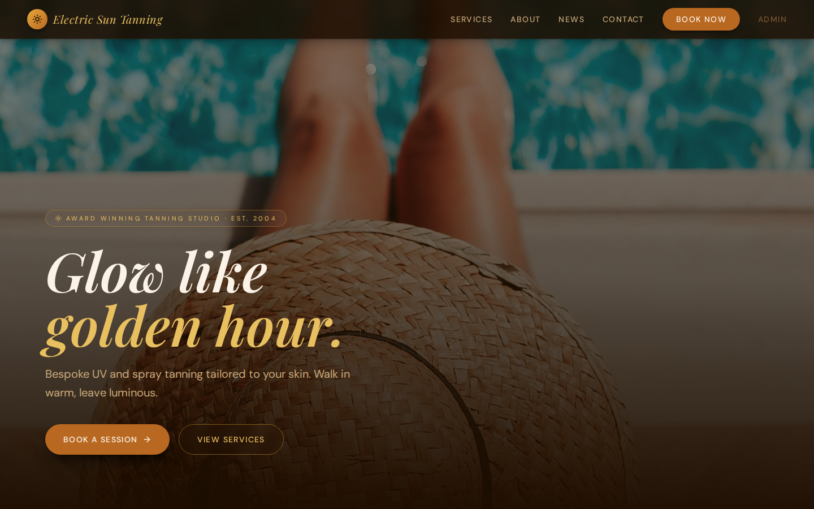
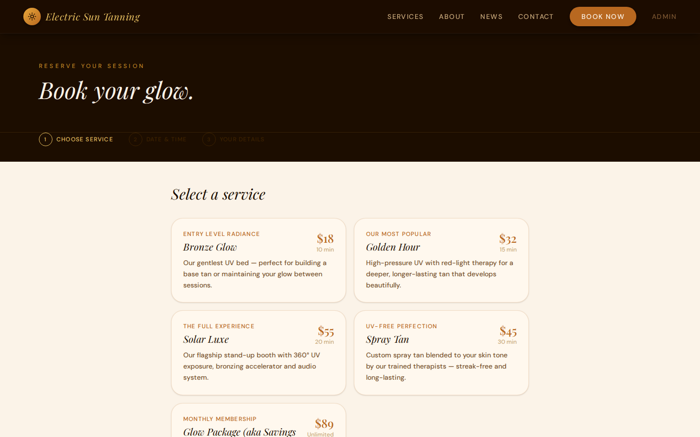
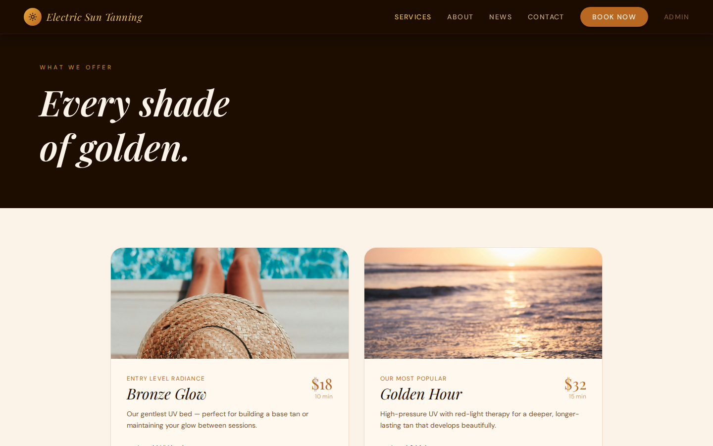
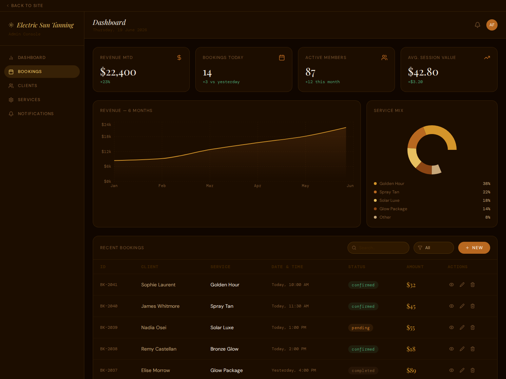
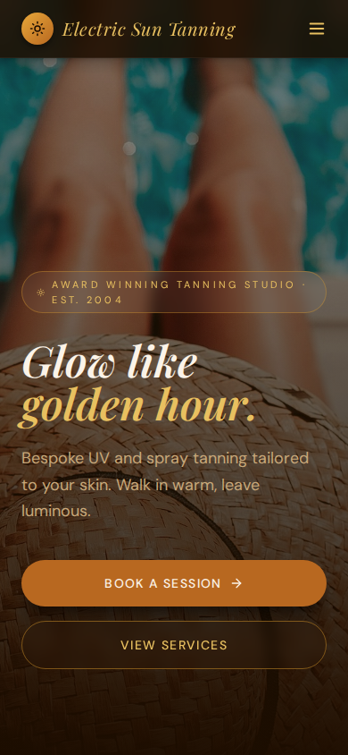

# Tanning Salon Booking & Analytics Platform

A complete website and management platform built for a local tanning salon in Caldwell, Idaho. Customers can browse services and book a session online in under a minute, and the salon team gets a private admin dashboard with revenue analytics, booking management, and client insight - all in one place.

---

## Screenshots

### Home
Warm, editorial home page with the salon's services, studio stats, and client reviews.



### Online Booking
A simple three-step booking flow: pick a service, choose a date and time, add your details - done.



### Services
Every treatment with photos, session length, pricing, and what's included.



### Admin Dashboard & Analytics
Revenue trends, service mix, today's bookings, and member activity at a glance - plus a searchable bookings table.



### Mobile
Fully responsive - booking works just as smoothly on a phone.



---

## What It Does

### For Customers
- **Browse services** - UV tanning levels, spray tanning, and the Glow Package membership (the salon's savings program), each with pricing, session times, and what's included
- **Book online, 24/7** - a three-step booking flow (service → date & time → your details) with an instant on-screen confirmation and booking summary
- **About the studio** - the salon's story, values, and team
- **News feed** - the latest studio updates and offers in a photo grid, styled after the salon's social posts
- **Contact & hours** - address, phone, email, opening hours, and a contact form
- **Works on any device** - phone, tablet, or desktop

### For the Salon Team (Admin Dashboard)
- **Revenue analytics** - month-to-date revenue and a six-month revenue trend chart
- **Service mix** - which services are selling, as a share of bookings
- **Key numbers at a glance** - bookings today, active members, average session value
- **Booking management** - a searchable, filterable table of recent bookings with status (confirmed / pending / completed / cancelled) and amounts
- **Client & service sections** - navigation ready for client records and service management

---

## A Note for the Client

This platform was designed around how your studio actually runs: clients discover a service, book in a few taps, and walk in knowing what to expect - while you start the day with one clear view of revenue, bookings, and members instead of a paper diary.

Everything a visitor sees - services, prices, session times, hours, photos, and news posts - lives in one place in the code (`src/app/App.tsx`), so updates like a price change or a new service are quick, single-spot edits. The admin dashboard currently runs on sample data to demonstrate the experience; connecting it to a live booking database and payment provider is the natural next step when you're ready to take bookings through the site directly.

---

## Run It Locally

You'll need [Node.js](https://nodejs.org) 18 or newer.

```bash
# 1. Install dependencies
npm install

# 2. Start the development site
npm run dev
```

Then open the local address Vite prints (usually http://localhost:5173).

```bash
# Build a production version
npm run build

# Preview the production build locally
npx vite preview
```

**Finding your way around:** use the top navigation for Services, About, News, and Contact; **Book Now** opens the booking flow; **Admin** (top right) opens the staff dashboard. Pages can also be linked directly, e.g. `/#booking` and `/#admin`.

---

## Tech Stack (in plain terms)

- **React + TypeScript** — the interactive website itself, built with type-safe code
- **Vite** - the build tool that makes the site fast to develop and quick to load
- **Tailwind CSS** - the styling system behind the warm cream / espresso / amber design
- **Recharts** - the revenue and service-mix charts in the admin dashboard
- **Lucide icons** - the clean line icons throughout

Design language: warm luxury boutique - cream and espresso tones with amber and gold accents, Playfair Display headlines with DM Sans body text. Full brand notes live in `guidelines/Guidelines.md`.

---

## Project Structure

```text
src/
├── main.tsx                 App entry point
├── app/
│   ├── App.tsx              All pages: Home, Services, Booking, About,
│   │                        News, Contact, and the Admin dashboard
│   └── components/
│       ├── ui/              Reusable interface components (buttons, cards,
│       │                    dialogs, tables, forms…)
│       └── ImageWithFallback.tsx
└── styles/                  Theme, fonts, and global styles
docs/
└── screenshots/             The screenshots shown above
guidelines/
└── Guidelines.md            Brand & design guidelines
```
